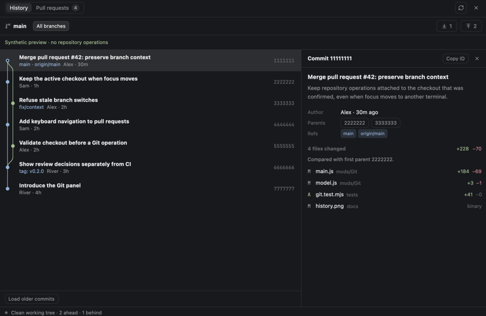
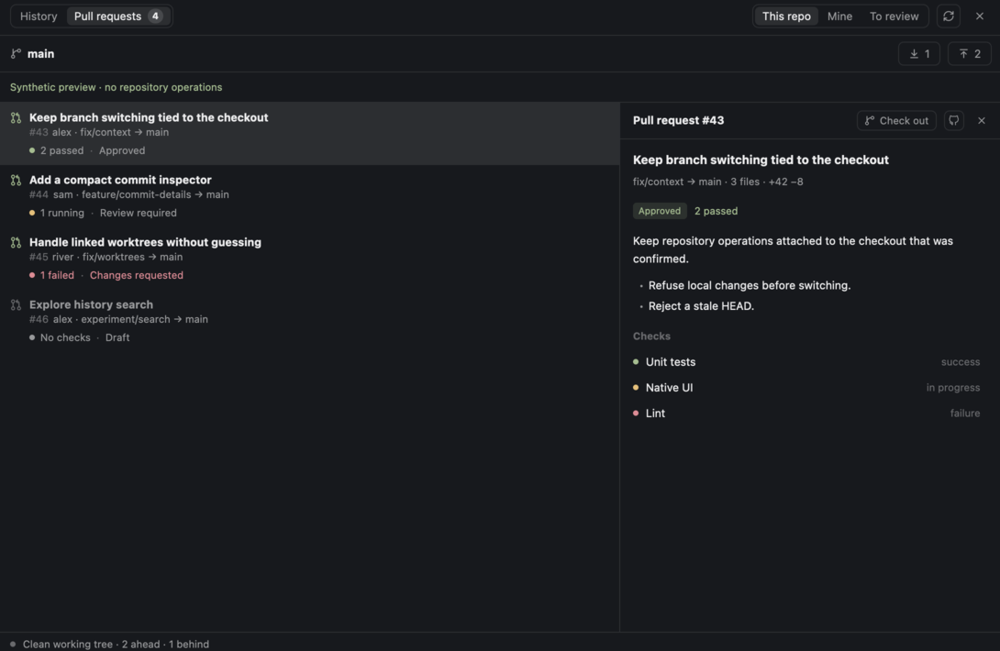

# Git for Herdr

A native Git panel that sits beside Codewalker Review. Commit history first; pull requests and branch switching one click away.



## What it does

- Draws the commit DAG with colored lanes, merges, HEAD, branch and tag labels. Load older commits or limit history to the current branch.
- Lists open PRs for **This repo**, **Mine**, or **Review requested**. Shows CI and review decisions separately; missing checks never count as passing.
- Opens commit summaries and PR descriptions/checks. **Check out** switches to a PR with `gh pr checkout`, including forks.
- Switches local branches or creates a tracking branch from a remote ref. Branches held by other worktrees are marked and cannot be switched here.
- Pulls fast-forward only. Pushes only the named branch, without force, follow-tags, or recursive submodule pushes. Unpublished branches offer **Publish**.
- Follows the focused terminal’s checkout, including remote spaces. A `folder` prop pins a copy to one checkout.



Both screenshots are native Herdr captures of explicitly synthetic fixtures, not GitHub data.

## Install

Requires a recent Herdr with `gpui-base` virtual lists and `PathBuilder`, Git, and GitHub CLI (`gh auth login`). Remote spaces need Git and `gh` on that machine. No Node runtime is needed by the mod.

```sh
python3 scripts/install.py
herdr-app check ~/.config/herdr-app/mods/Git
```

The installer honors `HERDR_APP_HOME`, copies only `mods/Git/`, and refuses to replace a mod installed from somewhere else. It **never writes layouts, settings, or keybindings**.

### Use in any layout

Open a standalone window without editing a layout:

```sh
herdr-app do mod.open --name Git
```

Or use `content: {"mod":"Git"}` in a personal layout. Optional props:

| Prop | Meaning |
|---|---|
| `folder`, `on` | Pin a checkout and its machine; omit to follow focus. |
| `framed: true` | Omit the outer card border when embedded in a pane. |
| `toolbar: true` | Render only the GitHub entry button. Without `dock`, opens a standalone window. |
| `dock: {panel, stack, child}` | Optional host-supplied node IDs for a docked panel. No layout names or IDs are hardcoded. Put the same prop on the toolbar and panel copies. |

A pane can be opened with the normal `pane.split` command and `mod: "Git"`. No layout is shipped or created by this package.

### Shizen integration on this machine

Only `~/.dotfiles/tag-herdr/config/herdr-app/layouts/Shizen.json` was edited: a 64px **Git** button (icon and label, styled like Review) before Review, plus a `Git` child in the existing panel stack. Its rcm symlink is preserved. Existing dimensions, other mods, user layouts, and keybindings were left alone.

Commands delivered to visible copies: `Git.history`, `Git.prs`, `Git.branches`, `Git.refresh`. In a focused list, Up/Down select rows; Enter opens a row or asks to switch a branch. Escape dismisses confirmation/details before returning from the branch picker.

## Write safety and access

Every checkout, pull, and push asks for confirmation and names its checkout. Operations capture that context and revalidate HEAD, branch and upstream before writing. Checkout and pull refuse local changes; nothing is automatically stashed, reset, rebased, or forced. Git also refuses occupied worktrees and conflicting updates.

The mod runs `git` and `gh` through Herdr’s `exec`, without interpolated shell commands. It reads checkout metadata and uses existing Git/`gh` credentials; it stores no tokens. PR reads contact the configured GitHub host. Pull/push/PR checkout contact configured remotes. Git hooks and credential helpers may run as part of Git’s normal behavior. HTTPS links open only on an explicit click. No agents, installers, helper downloads, or telemetry are launched.

Git does not provide a transaction spanning our preflight and an external checkout process. Another terminal can still change the checkout after the check; Git’s normal locks/refusal rules remain the final guard. A timeout or transport failure can leave a partial result: inspect the repository before retrying. Writes are never automatically retried.

## Limits

- Remote refs and ahead/behind counts are from the last Git fetch; Refresh reads local state, it does not fetch. Pull fetches its upstream.
- History loads 150 commits at a time; PRs load 50 at a time. Lists are virtualized. Commit details list up to 300 changed files; PR bodies are capped at 12,000 characters and detail views at 80 checks. GitHub has the complete PR.
- Local reads poll every 15 seconds, PRs every 60 seconds while that docked view is visible. Hidden docked panels do not poll. Standalone/pane copies without a `dock` descriptor use the same gentle polling even if their host is hidden.
- Herdr `exec` has a 30-second/8-MiB limit. Large repositories or slow network operations can exceed it.
- No merge/rebase/reset, staging, commit creation, CI reruns, or automatic branch cleanup. Codewalker remains the code-review surface.

## Verification

```sh
npm test                         # real Git fixtures; only temporary local remotes
python3 scripts/check-ui.py       # populated native descriptions and deferred-row fixtures
herdr-app check mods/Git
```

Nine behavior tests cover DAG topology, unborn/detached checkouts, dirty/stale/worktree refusal, tracking branches, publish/push/pull/divergence, status parsing, honest CI states, PR preflight, PR load-failure causes, and commit details (root, binary, deleted, merge). Twelve native checks cover virtual/eager rows, narrow/wide views, details, and confirmations. Native screenshots were inspected for history and PRs; a live repository’s history was also observed. A read-only `gh pr list` succeeded against an existing checkout (zero open PRs). No real GitHub checkout/push/pull or pointer-driven interaction test was performed.

`python3 scripts/check-ui.py --preview history` (or `prs`/`branches`) opens an isolated, non-writing synthetic preview mod. Close that overlay, then run `--clean-preview` to remove it. This creates no layout.

See [design](DESIGN.md) and [source notes](docs/inspiration.md).
