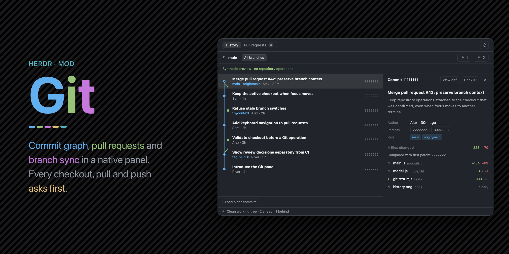

# Git

A native Git panel for the checkout of the focused terminal. It shows the commit graph first, open pull requests one click away, and branch switching from the branch name. Pull, push, branch switch and PR checkout each ask for confirmation in the panel, and name the checkout, before anything changes.

## What you see

Top to bottom, in the host theme and UI font (no private palette). Panel text is 13px. Section and row headings are 12px semibold, metadata 11px, compact status labels 10px. Monospace is used only for object IDs.

1. **Mode row, 42px.** A segmented control (26px frame, 20px segments) with **History** and **Pull requests**. The PR segment carries a round count pill (`50+` when more exist). On the right: the PR scope filter (**This repo / Mine / To review**) when the panel is 500px or wider and PRs are shown, then a GitHub icon button (only when the repository's remote is on GitHub), then a Refresh icon button, then (docked copies only) a 26px expand button as the last control (`maximize-2`, or `minimize-2` in the selected look while expanded).
2. **Branch row, 40px.** A branch icon and the current branch name: a button that opens the branch picker, with the repository path in its tooltip. In History, an **All branches** toggle (`All` below 400px). On the right: Pull with the incoming count and Push with the outgoing count, or **Publish** for a branch without an upstream. In the branch picker this row becomes a "Find a branch" search field. Below 500px the PR filter takes its own 40px row here.
3. **Error band** (only on error): blocked-color text on a 10% blocked tint, with a dismiss button.
4. **Body.** The list, plus details for the selected row. At 760px and wider the details sit to the right of the list, `min(420px, 40%)` wide. Narrower, they stack below it at half the height, between 180px and 440px.
   - **History rows, 48px.** A graph cell (lanes 12px apart, lane 0 centered 6px from the 14px gutter, 1.5px Bézier strokes, 8px dots, HEAD drawn as a 2px ring), a semibold subject, then ref labels in the accent color, author and age. The short hash is right-aligned in dim monospace at 560px and wider. Lane colors cycle through theme `accent`, `ansi2`, `ansi5`, `ansi3`, `ansi6`, `ansi4`. A 36px **Load older commits** row follows the last commit.
   - **PR rows, 68px.** A PR icon in `ansi2` (dim for drafts), the title, then a byline: dim `#number`, author, `head → base`. A status line 5px below: CI dot and label, a dim separator, then the review state. Only failures and "Changes requested" use colored text (`ansi1`).
   - **Branch rows, 48px.** Local branches, then remote branches that can become tracking branches. A branch checked out in another worktree is marked with that path and cannot be switched here.
   - **Commit details.** A 40px header with "Commit 1234abcd", **View diff** (only when Codewalker is installed and the checkout is local), **Copy ID**, and close. Then the subject, the message rendered as Markdown, and facts in a 64px label column: author, committer (when different), parents as buttons that select them, refs as pills (tags in `ansi3`). Then "N files changed" with total +/−, "Compared with first parent …" for merges, and file rows: status letter (A green, D red, R/C accent), file name, dim folder, +/− counts or "binary". Up to 300 files are listed.
   - **PR details.** A header with **Check out** and an open-on-GitHub button. Then the title, `head → base · files · +/−`, review and CI pills, the description as Markdown (capped at 12,000 characters), a merge-conflict warning if there is one, and up to 80 check rows with a state dot.
5. **Confirmation** (only while asking): on the surface color, with the title (for example "Push main?"), what will happen, the checkout path (and machine), then **Cancel** and **Confirm**.
6. **Footer, 26px.** A 6px status dot (idle, working, or blocked color) and text like "Clean working tree · 2 ahead · 1 behind", "3 changed", "not published", plus "Reading PRs…" while loading.

Every list shares one left edge: a 14px gutter, a 13px icon or lane-0 column, and an 8px gap. Controls are 26px (small ones 22px) with 6px corners. When the panel is not framed by the host, it has a 10px-radius card with a 1px theme border.

The `toolbar: true` copy draws only a 26px "Git" button with a GitHub icon, right-aligned on the chrome color. It is selected while its docked panel is shown.

## How it behaves

- **Follows focus.** Without a `folder` prop, the panel reads the focused terminal's folder and machine on every render. When they change, it resets and reads the new checkout. A `folder` prop (with optional `on` and `pane`) pins a copy to one checkout.
- **Polling.** Local state is read every 15 seconds and PRs every 60 seconds, but only while the panel is visible and nothing is pending. Refresh reads local state again; it does not fetch. PRs load together with the repository, so the count is ready before the tab opens.
- **Open on GitHub.** The GitHub button opens `https://<host>/<owner>/<repo>` for the upstream's remote, else `origin`, else the only remote. Remote URLs come from `git remote -v`; scp-style, `ssh://` and `https://` forms work, credentials are dropped, and only hosts with "github" in their name count. The tooltip names `<host>/<owner>/<repo>`.
- **Clicks.** A commit or PR row selects it and loads its details. A branch row asks to switch. A parent button selects that commit. Links open only on a click. Copy ID writes the full hash to the clipboard and shows "Copied".
- **Keys** (when the panel has focus): Up and Down move the selection and open its details (in the branch picker they only move the cursor). Enter opens the row or asks to switch the branch. Escape closes, in this order: the confirmation, the details, the branch picker.
- **Writes.** Pull (`--ff-only`, no autostash), push (named branch only, no force, no follow-tags, no submodule recursion, `--set-upstream` only to publish), branch switch (`git switch --no-guess`, or `--track` for a remote ref) and PR checkout (`gh pr checkout`) all show the confirmation first. On Confirm, the panel checks again that the root, HEAD, branch, upstream and target are unchanged. Checkout and pull refuse local changes. All writes refuse unresolved conflicts. A failed write is never retried.
- **View diff** opens Codewalker's commit review in a new pane to the right of the pane the panel follows: `pane.split` with `mod: "Codewalker"` and props `{framed, folder, scope: "commit", commit}`.
- **PR load failures** name one cause with a fix and a copyable command: no remote, no GitHub remote, no default repository (`gh repo set-default`), not signed in (`gh auth login`), or `gh` missing. Raw `gh` output appears only for unknown causes. The filter is hidden when it cannot help.
- **Docked toolbar.** With a `dock: {panel, stack, child}` prop, the toolbar button selects that stack child and shows or hides the panel. It also adds `child` to the shared `workspace.panels` list. Without `dock`, it opens the panel as an 1100×720 window overlay.
- **Expand and restore** (docked copies whose `dock` matches the layout, panel directly in a `row`). Without `max` on the panel, Expand hides the visible row siblings and resizes the panel to weight 1. With a finite `max`, it resizes the panel to `max` px and hides nothing; at `max` already, the button is disabled. Before any command, a receipt is written to the shared map `workspace.expanded.v1[layoutName]`: `{v:1, layout, panel, stack, row, hidden, size, mode, max, by, at, restoring, error}`. Restore shows only the recorded siblings still in that row, resizes the panel to the recorded size (weight 1 if none), and deletes the receipt once `layout()` shows the result; after 5 seconds it keeps the receipt with an error. Hiding the panel, or the stack showing a mod other than Git or Codewalker, restores it on its own (from a task, never during render), unless the receipt has an error. The toolbar button restores before it hides the panel.
- **App commands** to shown copies: `Git.history`, `Git.prs`, `Git.branches`, `Git.refresh`, `Git.expand` (expand toggle; docked copies only), and `focus` (`mod.json` has `"focusable": true`).

## Built from

- `mods/Git/main.js`: the `View` (gpui-kit) with gpui-base `h_flex`, `v_flex`, `Button`, `InputState`, `Input`, `TextView` (Markdown), `v_virtual_list`, `Scrollbar` and `VirtualListScrollHandle`. From `herdr` it uses `exec`, `props`, `focused`, `spaces`, `panes`, `theme`, `settings`, `layout`, `run`, `openOverlay`, `nextCommand`, `shared`, `setShared`, `readTextFile` and `appHome`. App commands: `layout.select`, `layout.show`, `layout.hide`, `pane.split`.
- `client.js`: all Git and `gh` calls, through `exec(program, args, {cwd, on})` with no shell. Reads use `git --no-optional-locks -c color.ui=false`: `rev-parse`, `status --porcelain=v2 -z`, `log --topo-order` (150 per page, all refs or HEAD only), `for-each-ref`, `remote`, `show -s`, and `diff-tree --numstat/--name-status`. PRs use `gh pr list --json` (50 per page; `--author @me`, `--search review-requested:@me`) and `gh pr view --json`.
- `model.js`: parsers, the CI summary (missing, skipped and unknown checks never count as passing), `actionArgs` for write arguments, and `prProblem` for failure causes. `lanes.js`: the lane layout, reused under MIT from rabeeh-ta/herdr-git-graph (license in `LICENSE-lanes`). `ui.js`: buttons, segments, pills and the graph cell (`PathBuilder` strokes painted with `window.paint_path`). `codewalker.js`: Codewalker detection and the pane-split arguments. `dock-expand.js`: the expand/restore planner and controller, with no imports (Herdr functions are passed in); Codewalker ships an identical copy.
- `icons/`: 1.7–2px stroke SVGs, tinted with the text color (see `icons/LICENSE`).
- `mod.json`: `"place": "none"`, focusable, window overlay 1100×720. No layout or `keys.json` ships.
- Programs: `git` and GitHub CLI `gh` (signed in), on the machine of the checkout.

## Watch out

- The folder name is the mod name. `MOD` in `ui.js` holds it for icon paths, the dock check and the overlay. If you rename the folder, change that one constant.
- A community mod named `git` exists. On case-insensitive file systems (the macOS default), `mods/git` and `mods/Git` are the same folder.
- `herdr-app check` does not enter deferred virtual-list rows. Render rows eagerly in a fixture to check them (`scripts/check-ui.py`). Put list events on `on_item_click`, never inside a row renderer. Give the virtual list a relative parent and overlay its scrollbar, or a flex-only list can collapse to zero height.
- `exec` has a 30-second, 8 MiB limit. Large repositories or slow remotes can exceed it, and a timed-out write can be partly done.
- Remote refs and ahead/behind counts come from the last fetch. Only Pull fetches.
- View diff needs a local checkout, a live pane to split, and `mods/Codewalker/main.js` and `backend.py` readable in the app home. Git only reads those files; it never installs or runs Codewalker to detect it.
- There is no merge, rebase, reset, staging, commit creation, CI rerun or branch deletion. Another terminal can still change the checkout between the check and the write. Git's own locks are the final guard.
- Hooks and credential helpers run as Git normally runs them.
- Expand must not use `layout.set`: on a personal layout it rewrites the file and clears every click. `max` is a file field, not a click, so Expand never removes it. `run()` only queues a command and returns null, so a restore is confirmed by reading `layout()` later; a `cx.timer.after` check covers a restore that never applies. Do not `cx.notify()` while a restore is only waiting, or render and reconcile loop.

## Done when

- `herdr-app check mods/Git` passes.
- `herdr-app do mod.open --name Git` in a repository shows the graph with HEAD as a ring, merge curves, and ref labels without `HEAD ->`.
- Selecting a merge commit shows "Compared with first parent", its files with +/− counts, and parent buttons that select those commits.
- With Codewalker installed and a local checkout, **View diff** opens Codewalker to the right of the followed pane. Without Codewalker, the button is hidden and the files section says to install it.
- The Pull requests tab lists open PRs with separate CI and review states. Mine and To review filter them. A checkout without a remote shows "This checkout has no remote" with a copyable command.
- Pull and Push show a confirmation with the checkout path. Pull with local changes refuses with "Commit or stash your local changes first. Nothing was changed."
- Focusing a terminal in a different repository switches the panel to that repository within one render.
- In a docked panel without `max`, Expand hides the terminals block and the panel fills the row; Restore brings back the same blocks and the previous width. Selecting Files in the panel's stack while expanded restores it.
- `node --test tests/dock-expand.test.mjs` passes.
